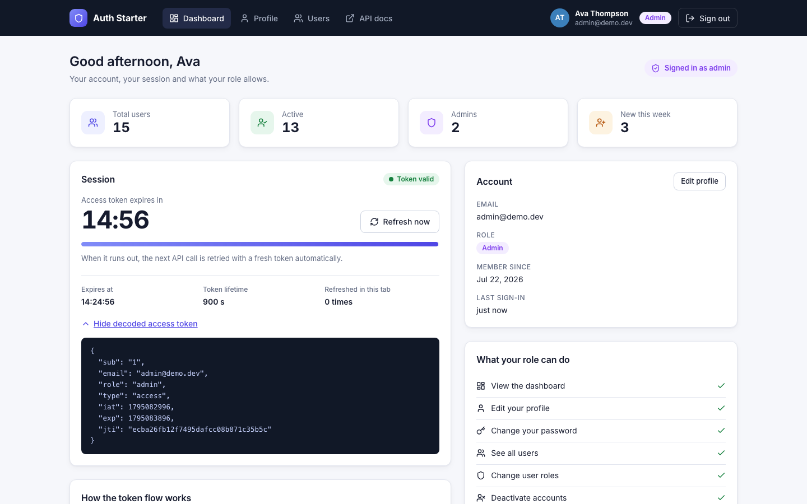
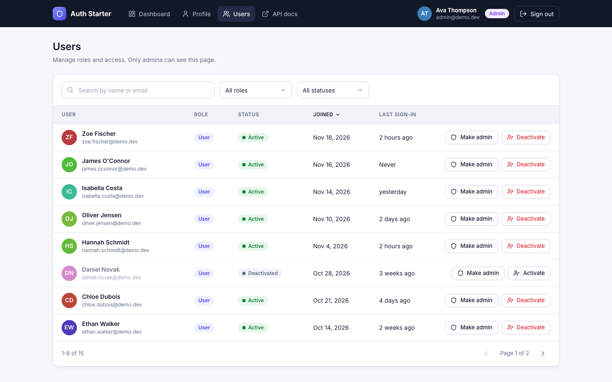
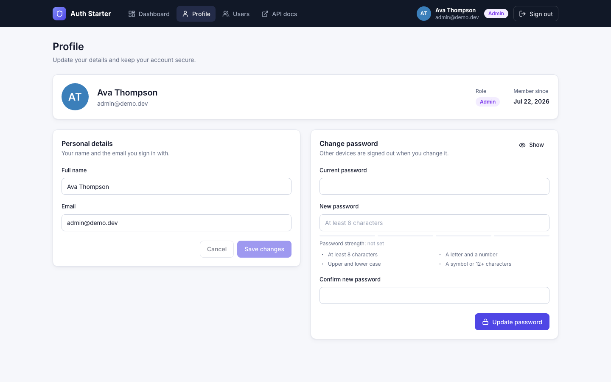
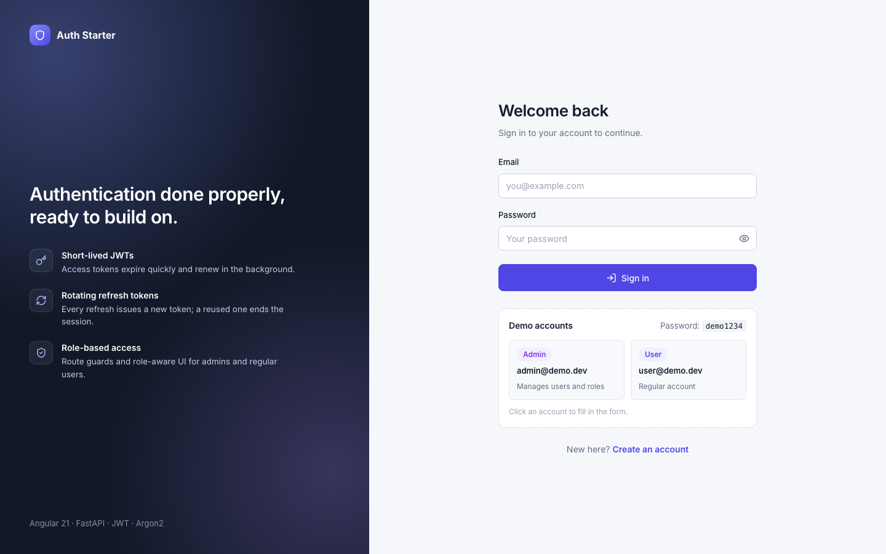
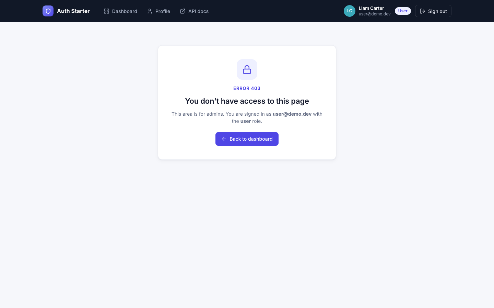

# Auth Starter

Full-stack authentication starter: Angular 21 frontend and FastAPI backend with short-lived JWT access tokens, rotating refresh tokens and role-based access.

**Live demo:** https://hkhodkar.github.io/auth-starter/

Sign in with one of the demo accounts shown on the login page (`admin@demo.dev` or `user@demo.dev`, password `demo1234`). The demo runs entirely in your browser: an in-browser mock API issues JWT-shaped tokens that expire after 60 seconds, so you can watch the refresh flow happen.



| Users (admin only) | Profile |
| --- | --- |
|  |  |
| **Login with demo accounts** | **403 for the wrong role** |
|  |  |

## Features

**Backend (FastAPI)**

- Register, login, refresh, logout and `/me` endpoints under `/api/auth`
- Passwords hashed with Argon2id (`pwdlib`), timing-safe login for unknown emails
- Short-lived access tokens (HS256 JWT, 15 minutes by default)
- Opaque refresh tokens stored as SHA-256 hashes, rotated on every refresh
- Reuse detection: presenting a used refresh token revokes the whole session
- Logout revokes the session, a password change signs out every other device
- Profile update and change password for the signed-in user
- Admin-only user list with search, role/status filters, sorting and paging, plus role change and deactivate (admins can't lock themselves out)
- Roles are read from the database on each request, so a demotion takes effect immediately
- Demo accounts seeded on startup, pytest suite for auth flows and role checks

**Frontend (Angular)**

- `AuthService` built on signals (`user`, `isAuthenticated`, `role`, token expiry)
- Functional HTTP interceptor that attaches the Bearer token and, on a 401, refreshes once and retries; concurrent requests share a single refresh and requests made during a refresh wait for it
- `authGuard`, `guestGuard` and `roleGuard('admin')`, return URL after login
- `*appHasRole` structural directive for role-aware UI
- Login and register with typed reactive forms, password strength meter, confirm password, show/hide password
- Dashboard with a live access token countdown, refresh counter and decoded JWT claims
- Profile page (details + change password), admin users page, 403 and 404 pages
- Session restored on reload and kept in sync between tabs
- Demo mode: a mock API interceptor with the same routes, validation errors and token rules as the backend, data stored in `localStorage`, with a "Reset data" action

## Tech Stack

- **Frontend:** Angular 21 (standalone components, signals, zoneless, OnPush, new control flow, lazy routes), TypeScript, SCSS, Vitest
- **Backend:** Python 3.12, FastAPI, Pydantic v2, SQLAlchemy 2, SQLite, PyJWT, pwdlib (Argon2), pytest
- **Tooling:** Docker Compose, GitHub Actions (CI + GitHub Pages deploy)

## Getting Started

### Docker

```bash
docker compose up --build
```

- App: http://localhost:8080
- API docs (Swagger UI): http://localhost:8000/docs

Set `JWT_SECRET` to a long random value for anything other than local use. `ACCESS_TOKEN_MINUTES` and `REFRESH_TOKEN_DAYS` control token lifetimes.

### Local development

Backend (Python 3.12):

```bash
cd backend
python -m venv .venv && source .venv/bin/activate
pip install -r requirements-dev.txt
uvicorn app.main:app --reload        # http://localhost:8000, docs at /docs
pytest                               # run the tests
```

Frontend (Node 22+):

```bash
cd frontend
npm install
npm start                            # http://localhost:4200, /api is proxied to :8000
npm test -- --watch=false            # unit tests
npx ng build --configuration demo    # build with the in-browser mock API
```

If the backend isn't running, the dev server switches to demo mode on the first failed API call, so the UI still works.

### Configuration

| Variable | Default | Description |
| --- | --- | --- |
| `DATABASE_URL` | `sqlite:///./auth.db` | SQLAlchemy database URL |
| `JWT_SECRET` | random per start | Secret used to sign access tokens |
| `ACCESS_TOKEN_MINUTES` | `15` | Access token lifetime |
| `REFRESH_TOKEN_DAYS` | `7` | Refresh token lifetime |
| `SEED_DEMO_DATA` | `true` | Create the demo accounts on an empty database |
| `CORS_ORIGINS` | `http://localhost:4200` | Comma-separated list of allowed origins |

## API

| Method | Path | Access | Description |
| --- | --- | --- | --- |
| POST | `/api/auth/register` | public | Create an account, returns a token pair |
| POST | `/api/auth/login` | public | Email + password, returns a token pair |
| POST | `/api/auth/refresh` | refresh token | Rotate the refresh token, returns a new pair |
| POST | `/api/auth/logout` | refresh token | Revoke the session |
| GET | `/api/auth/me` | user | Current user |
| PATCH | `/api/auth/me` | user | Update name or email |
| POST | `/api/auth/me/password` | user | Change password, signs out other sessions |
| GET | `/api/users` | admin | List users (`search`, `role`, `status`, `sort`, `page`, `page_size`) |
| GET | `/api/users/stats` | admin | User counts for the dashboard |
| PATCH | `/api/users/{id}` | admin | Change `role` or `is_active` |

Full interactive docs at `/docs` when the backend is running.

> The refresh token is returned in the response body and kept in `localStorage` so the static GitHub Pages demo can work. For a production app on a single domain, consider moving it to an `HttpOnly`, `SameSite` cookie.

## Project Structure

```
auth-starter/
├── backend/
│   ├── app/
│   │   ├── routers/        # auth and admin user routes
│   │   ├── security.py     # password hashing and JWT helpers
│   │   ├── tokens.py       # refresh token issue, rotation and revocation
│   │   ├── deps.py         # current user and admin dependencies
│   │   ├── models.py       # User and RefreshToken tables
│   │   └── seed.py         # demo accounts
│   └── tests/              # pytest suite
├── frontend/
│   └── src/app/
│       ├── core/
│       │   ├── auth/       # auth service, interceptor, guards, token storage
│       │   ├── api/        # users API client, error helpers
│       │   └── mock/       # in-browser mock API for demo mode
│       ├── features/       # auth pages, dashboard, profile, admin users, errors
│       ├── layout/         # app shell and auth layout
│       └── shared/         # UI components, form helpers, has-role directive
├── docs/                   # screenshots
└── docker-compose.yml
```

## Author

Hatef Khodkar – [github.com/hkhodkar](https://github.com/hkhodkar)

## License

MIT
